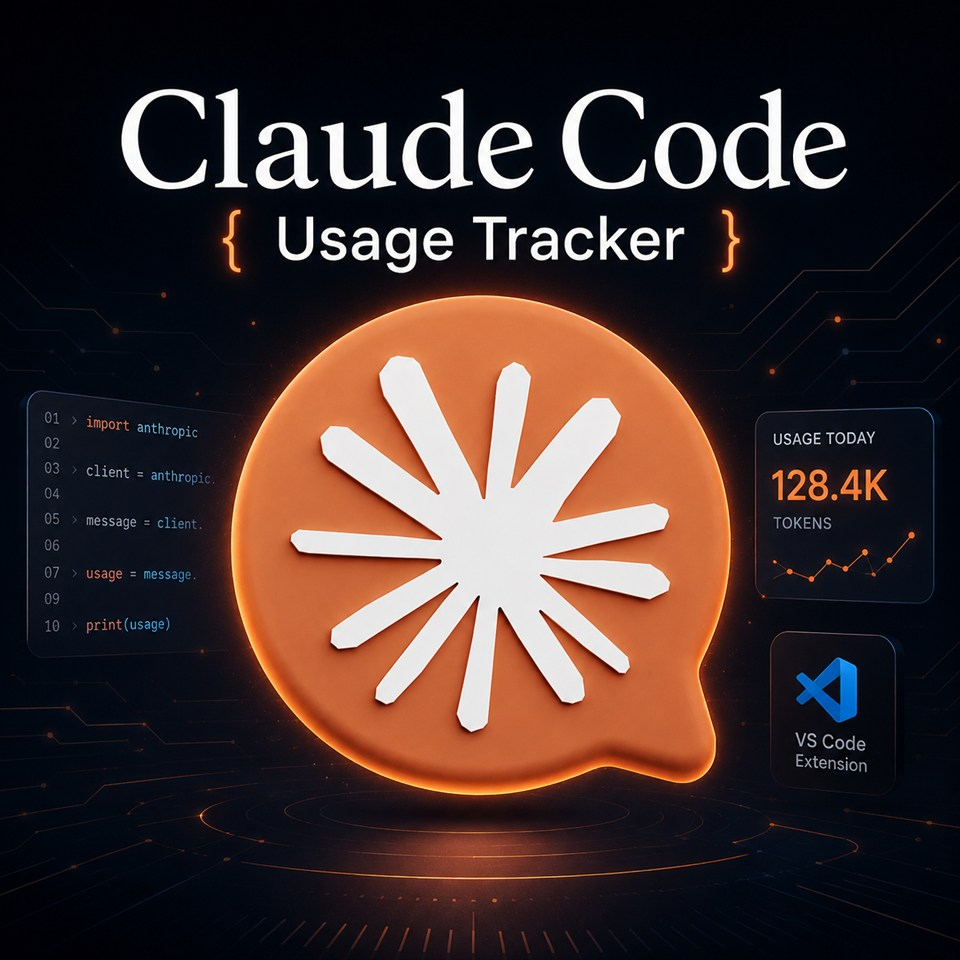
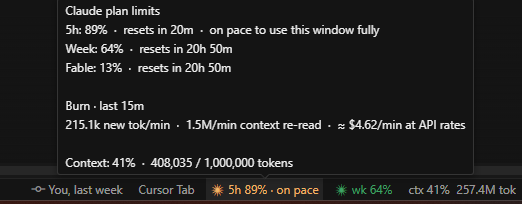
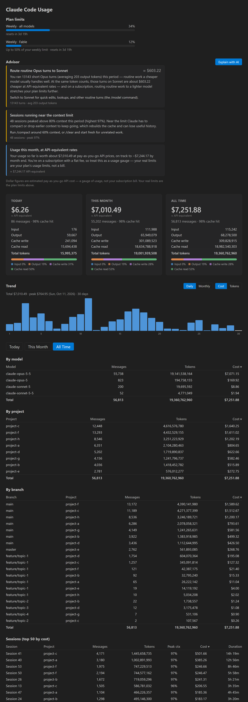
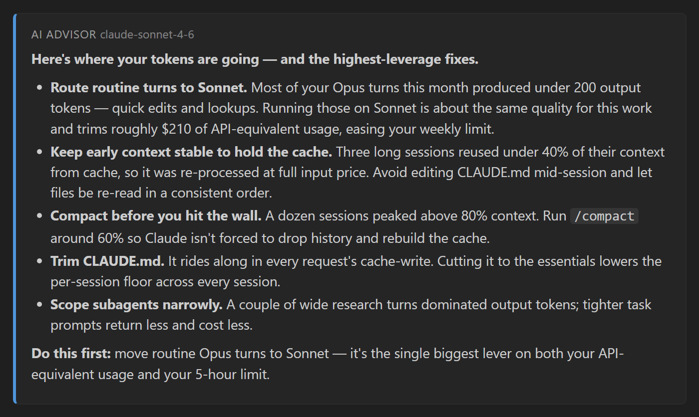
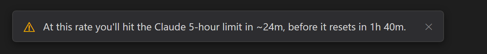

<p align="center">
  
</p>

<p align="center">
  A VS Code / Cursor extension that surfaces your Claude Code plan-limit usage,
  context window, token counts, estimated cost, and usage trends from your local
  logs &mdash; in the status bar and a dashboard.
</p>

<p align="center">
  <b>Now supports the Ultra plan.</b> No 5&#8209;hour limit on your account? The weekly limit takes over the live pace meter, and your Fable limit gets its own warnings.
</p>

<p align="center">
  
</p>

<p align="center">
  <sub>At a glance in the status bar &mdash; plan limits, context, cost, and tokens. The pace meter <code>5h 42% &rarr; 53%</code> reads &ldquo;at your current rate you're on track to finish the 5&#8209;hour window at <b>53%</b>.&rdquo; With no 5&#8209;hour limit, such as on a verified Ultra account, the weekly limit shows it instead: <code>wk 10% &rarr; 19%</code>.</sub>
</p>

<p align="center">
  
</p>

<p align="center">
  <sub>Hover any status-bar item for the full breakdown &mdash; here near the end of the 5&#8209;hour window at <b>89%</b>: each plan limit with its reset time and the <code>&middot; on pace</code> reading, your burn rate split into new work versus cached context re-reads, and context-window fill.</sub>
</p>

<p align="center">
  
</p>

<p align="center">
  <sub>The dashboard on a verified Ultra account: weekly and Fable limits with no 5&#8209;hour bar, ranked Advisor tips, then your usage by day, model, project, branch, and session. Project and session names here are placeholders.</sub>
</p>

## Features

- **Status bar** &mdash; plan-limit utilization (weekly, the 5-hour limit if your plan has one, and optionally your per-model weekly limit), each led by a Claude sunburst that turns green / yellow / red at your own warning thresholds (`predictiveAlerts.warnThresholds`, 75% / 90% by default), plus the current session's context-window fill, today's estimated cost, and token count. The limits, context, cost, and token readouts each have their own toggle. Click any of them to open the dashboard.
- **Plan limits** &mdash; real usage for each limit your plan has (5-hour, weekly, and per-model weekly such as Fable) with reset times, shown as bars in the dashboard. Which limits apply comes from Anthropic, so a verified Ultra account, which has no 5-hour limit, simply doesn't show one. Fetched live from Anthropic's usage endpoint (the same call Claude Code makes) so the numbers stay current even mid-session. Multiple open editor windows share a single fetch &mdash; and a single rate-limit backoff &mdash; so opening more windows won't push you onto a stale reading. A reading that has aged out is **hidden rather than guessed at**: the extension never presents an old window as a fresh `0%`.
- **Predictive alerts** &mdash; forecasts when you'll hit a limit and warns you before you do. The 5-hour limit gets a live **pace meter**: `5h 42% → 53%` means *at your current rate you're on track to finish the 5-hour window at 53%* (it climbs toward 100% as you push harder, so you can see at a glance whether you're cruising or about to run out). It appears from early in the window &mdash; damped toward your current utilization at first, so a thin early slice can't project an alarming number &mdash; and stays visible while you're idle. Near 100% it reads `· on pace` rather than committing to a knife-edge number, and that verdict is judged on the *undamped* pace, so a heavy early burn is never reported as on pace. The weekly limit shows a time-to-limit **ETA** only when you're genuinely on track to breach it &mdash; unless your plan has no 5-hour limit, in which case the weekly limit gets the pace meter instead (`wk 10% → 22%`). **Notifications** fire at configurable thresholds (75% / 90%), per-model weekly limits such as Fable included, and when your pace is clearly set to breach the 5-hour or weekly limit before it resets, and the tooltip shows your live **burn rate**, split into new work versus cached context re-reads (a long session re-reads its whole context every turn, which otherwise dominates the figure and makes it meaningless). An optional, off-by-default **model-cost advisor** suggests a cheaper model when you're burning an expensive one on routine turns. On by default and 100% local &mdash; configure under `predictiveAlerts.*`.
- **Extra usage (pay-as-you-go)** &mdash; optional, **off by default**: when your account has extra usage turned on (claude.ai now calls it *usage credits*), your spend beyond plan limits is shown in the status bar (`extra $3.50 / $50.00`), the tooltip, and the dashboard. Turn on with `showExtraUsage`.
- **Context window** &mdash; the latest request's prompt size as a percent of the model's window (like `/context`), taken from the Claude Code session running in this window's workspace, so each editor window shows its own conversation. The window comes from the model &mdash; 1M on Sonnet 4.6 / Opus 4.6 / Haiku 5.5 and later, 200K on Haiku 4.5 and earlier models &mdash; and subagent turns are excluded, so the figure tracks the conversation you're in instead of jumping every time a subagent runs. Their tokens still count everywhere spend is reported.
- **Advisor** &mdash; a panel in the dashboard with ranked, money-quantified tips to cut waste this month: routing routine turns to a cheaper model (with the estimated saving), long sessions that re-processed context uncached, sessions running near the context limit, and a month-end spend forecast. **Subscription-aware:** on a subscription such as Pro, Max or Ultra (where you pay a flat fee, not per token) it labels the dollar figures as *estimated API-equivalent usage* &mdash; a gauge, not a bill &mdash; and frames the advice around your plan limits. Computed entirely from your local usage data &mdash; no network call, no API key, and your prompts never leave your machine. On by default; turn it off with `advisor.enabled`. An optional **Explain with AI** button turns those signals into written, prioritized coaching &mdash; it calls Anthropic with **your own API key** &mdash; a key from the [Claude Console](https://platform.claude.com/settings/keys), separate from your Claude Code usage limits &mdash; stored in VS Code Secret Storage (set via the *Set Anthropic API Key* command, which links you straight to the console), sends only the usage summary by default, and never uses your Claude Code login. Prompt text is included only if you opt in (`advisor.ai.includePrompts`) and confirm, and only from the folders open in your window &mdash; never from your other projects.
- **Dashboard** &mdash; Today / This Month / All Time cards (All Time reaches as far back as your local logs go) with a full input / output / cache-write / cache-read token breakdown, cache-hit rate, and a cost-composition bar. Below them, sortable breakdowns: **by model**, **by project** (grouped by git repo, folder, or path), **by git branch**, and **by session** (titles, peak context, active-time duration) &mdash; each footed with a **totals** row (messages, tokens, cost).
- **Trend** &mdash; a bar chart of usage over time: daily across the current month or monthly across all time, switchable between cost and tokens, with the current day highlighted and a running total / peak summary. Empty days and months are filled in, so gaps in usage stay visible.
- **Live updates** &mdash; a file watcher over your logs refreshes the figures the moment Claude Code writes, with a timer as a fallback. Plan limits are fetched from Anthropic at most once every 3 minutes by default (`liveApiMinIntervalSeconds`).
- **Cost estimates** &mdash; from a per-model price table covering the current Fable, Opus, Sonnet, and Haiku models, including fast mode and 1-hour cache writes, and handling dated, suffixed, and Bedrock-prefixed model ids.

## How it works

Claude Code writes a JSONL transcript per session under `~/.claude/projects`. The
extension walks those logs and parses each line into a per-message usage record
&mdash; capturing model, working directory, git branch, and session id. A message is
written once per streamed content block, and only the final line of the group carries
the settled token counts (the earlier ones hold a placeholder), so duplicates collapse
to that last entry rather than the first. Records are
aggregated by day, month, and all-time, and grouped by model, project, branch,
and session, then priced with a per-model rate table. The daily and monthly
aggregates feed the trend chart; the rest feed the cards and breakdown tables.

Plan limits come from a second source. By default the extension fetches them
**live** from Anthropic's usage endpoint (`GET /api/oauth/usage` on
`api.anthropic.com`) &mdash; the same call Claude Code makes &mdash; authenticated
with Claude Code's OAuth token (from `~/.claude/.credentials.json`, or the login
Keychain on macOS, where Claude Code keeps it instead). This keeps your plan-limit
figures current even during a long session. If the live request fails, the extension
falls back to Claude Code's on-disk cache (`~/.claude/usage-cache.json`) &mdash;
though recent Claude Code versions no longer refresh that file, so in practice the
fallback that matters is the reading shared between your open editor windows.

A rolled-over window is reported as a fresh `0%` only while **both** the reset and
the reading itself are recent &mdash; that is the one case where `0%` is a fact
rather than a guess. Past that the current utilization is genuinely unknown, and the
window is hidden rather than invented; a payload older than a full weekly period is
refused outright. Anything still shown carries an "Updated X ago" note, so a stale
reading is never styled like a live one. The
utilization figures are already 0&ndash;100, so they're shown as-is; the green /
yellow / red tint follows your own `warnThresholds` (an explicit warning from the
server can raise it, never lower it). The context-window figure is the most recent
non-subagent request's prompt size (input + cache), from a session run inside one of
the window's workspace folders (any session, in a window with no folder open), over
the model's window &mdash; 1M
on Sonnet 4.6 / Opus 4.6 / Haiku 5.5 and later, 200K on Haiku 4.5 and earlier models. For an id the
table doesn't recognize, a prompt past 200K is itself proof of the larger tier.

**Privacy.** The live fetch reads your OAuth token from
`~/.claude/.credentials.json` (honoring `CLAUDE_CONFIG_DIR`), or from the login
Keychain on macOS, **read-only** &mdash; it is never written back &mdash; and talks
only to `api.anthropic.com`. It never refreshes the token itself &mdash; that is
left to Claude Code &mdash; so while the token is expired the last reading is shown
until Claude Code renews it. Set `useLiveApi` to `false` to read only
the local cache file and make no network requests.

The **Advisor** panel is computed entirely on-device. Its optional **Explain with
AI** button is the one feature that sends data off-device, and only when you click
it: it POSTs your usage summary to `api.anthropic.com/v1/messages` authenticated
with **your own** Anthropic API key &mdash; created at
[platform.claude.com/settings/keys](https://platform.claude.com/settings/keys)
(an API key, separate from your Claude Code subscription and its usage limits)
and kept in VS Code Secret Storage, never the Claude Code OAuth token. By default only metadata is sent &mdash; token counts,
costs, cache figures, model names, and the locally-computed tips, never any prompt
or response text. Prompt text is included only if you both turn on
`advisor.ai.includePrompts` and confirm the modal each time, in which case a small,
truncated sample of recent prompts is added so it can coach on prompt quality. Those
samples are drawn **only from the folders open in your window** &mdash; the modal names
the workspace it is reading from, prompts from your other projects are never included,
and nothing is sent when no folder is open. The
key is read locally and never leaves your machine; it is never bundled with the
extension or shared with anyone else.

<p align="center">
  
</p>

<p align="center">
  <sub>&ldquo;Explain with AI&rdquo; turns the local signals into prioritized, written coaching &mdash; called with your own API key, framed around your plan limits when you're on a subscription.</sub>
</p>

If your account has pay-as-you-go **extra usage** enabled, that same usage
response carries your spend beyond plan limits. With `showExtraUsage` on (it is
**off by default**), the extension shows it as `extra <spent> / <cap>` in the
status bar and an Extra usage section in the dashboard. Amounts come straight
from Anthropic (minor units + currency); nothing is shown when your account has
extra usage disabled.

**Predictive alerts** turn those limit figures into a forecast, computed from your
*average* consumption over the current window so far (`resets_at` minus the window's
length gives the start), so each window is judged on its own timescale &mdash; the
5-hour window over hours, the 7-day window over days.

The **5-hour** window shows a live pace meter: the projected end-of-window utilization at
your current rate (`5h 23% → 45%`), climbing toward 100% as you burn faster. Early in the
window it *damps* that projection toward your current utilization, because the raw
extrapolation divides by the elapsed time and a tenth of the way in one percentage-point
tick becomes ten (`5h 15%` would read a raw `→ 150%`); the meter firms up to the plain
projection by the time the window is half over. It stays visible while you're idle &mdash;
there it simply eases downward on its own &mdash; but the breach *popup* still needs recent
activity, so a heavy start followed by an hour of nothing won't keep warning you. And within
ten points of 100% it reads `· on pace` rather than a number, because there the projection
is a coin flip that flips back on the next refresh. The **weekly** window stays quiet and
shows a time-to-limit ETA only once you're on a trustworthy track to breach it before reset
(its figure moves over days, so a constant readout would be noise).

The exception is a plan with no 5-hour limit, such as a verified Ultra account. The weekly
limit is then the only one you have, so it takes over the pace meter (`wk 10% → 22%`), with
the same rules on a weekly scale: it appears about 17 hours into the week and firms up by
the half-mark. This depends on whether your plan has the limit, not on whether a reading
happens to be available, so a stale 5-hour figure on another plan won't switch it on.

Threshold and pace-based **warnings** fire once per window (re-arming when it resets). The
pace warning also waits until you're actually burning and clear of that same on-pace band,
so a popup never contradicts the meter. It covers the 5-hour and weekly limits; per-model
weekly limits get threshold warnings only. It all runs on the figures already on screen and
makes no extra network calls.

<p align="center">
  
</p>

<p align="center">
  <sub>A heads-up before you run out &mdash; fired only when you're projected to run past a limit before it resets, not merely on pace to use the window fully.</sub>
</p>

## Getting started

1. **Install** from the
   [VS Code Marketplace](https://marketplace.visualstudio.com/items?itemName=wheelbarrel00.claude-code-usage-tracker-wb00)
   or [Open VSX](https://open-vsx.org/extension/wheelbarrel00/claude-code-usage-tracker-wb00),
   or download a `.vsix` from the
   [Releases](https://github.com/wheelbarrel00/ClaudeCodeUsageTracker/releases) page
   and run `code --install-extension <file>.vsix` (or, in Cursor,
   `cursor --install-extension <file>.vsix`).
2. **Use Claude Code at least once** so it writes its logs under `~/.claude`. The
   extension reads them automatically &mdash; nothing to configure for the status
   bar, dashboard, and limits to populate.
3. **Sign in to Claude Code** (so your credentials exist &mdash; in
   `~/.claude/.credentials.json`, or the login Keychain on macOS) for live,
   always-current plan limits. Without it the extension can only read Claude Code's
   on-disk cache, which recent versions no longer write &mdash; so the limit items
   simply won't appear.
4. The status bar fills in on the next refresh. Click any segment, or run **Claude
   Code Usage Tracker: Show Dashboard** from the Command Palette, to open the
   dashboard. **Predictive alerts are on by default** &mdash; tune them under
   `predictiveAlerts.*`, or turn them off with `predictiveAlerts.enabled`.

## Settings

| Setting | Default | Description |
| --- | --- | --- |
| `claudeCodeUsageTracker.refreshIntervalSeconds` | `30` | How often to refresh usage data, in seconds (5–3600). |
| `claudeCodeUsageTracker.currency` | `USD` | Currency code for cost formatting. This changes the symbol only; amounts aren't converted. |
| `claudeCodeUsageTracker.decimalPlaces` | `2` | Decimal places for cost figures (0–6). |
| `claudeCodeUsageTracker.showLimits` | `true` | Show your plan limits: the weekly limit, plus the 5-hour limit if your plan has one. |
| `claudeCodeUsageTracker.useLiveApi` | `true` | Fetch current limits live from Anthropic's usage endpoint (using the local OAuth token); falls back to the cache file on failure, and to the reading shared between your open windows. Turn off to make no network requests. |
| `claudeCodeUsageTracker.liveApiMinIntervalSeconds` | `180` | Minimum seconds between live usage-endpoint requests (60–3600). Throttles network calls only; the status bar still refreshes on its normal interval. |
| `claudeCodeUsageTracker.showModelWeekly` | `false` | Also show your most-used per-model weekly limit (e.g. `fable NN%`) when your plan has one. Replaces `showOpusWeekly`, which still works. |
| `claudeCodeUsageTracker.showContext` | `true` | Show the current session's context-window fill (like `/context`). |
| `claudeCodeUsageTracker.showCost` | `true` | Show today's estimated cost. |
| `claudeCodeUsageTracker.showTokens` | `true` | Show today's token count. |
| `claudeCodeUsageTracker.showExtraUsage` | `false` | Show pay-as-you-go extra usage (spend beyond plan limits) in the status bar and dashboard. Only appears when your account has extra usage enabled. |
| `claudeCodeUsageTracker.projectGroupingMode` | `git` | Group the dashboard's By project breakdown by git repo (`git`), folder (`folder`), or full path (`flat`). |
| `claudeCodeUsageTracker.advisor.enabled` | `true` | Show the Advisor panel in the dashboard: ranked, money-quantified tips to cut waste (cheaper-model routing, cache reuse, context bloat, spend forecast). Fully local; nothing leaves your machine. |
| `claudeCodeUsageTracker.advisor.ai.model` | `claude-sonnet-5` | Model used by the Advisor's "Explain with AI" button (called with your own API key). Sonnet 5 is a capable, low-cost default; use an Opus id such as `claude-opus-5` for deeper analysis at higher cost. |
| `claudeCodeUsageTracker.advisor.ai.includePrompts` | `false` | When using "Explain with AI", also send a small, truncated sample of your recent prompts so it can coach on prompt quality. Only prompts from the folders open in this window are ever included. Off by default (metadata only); you confirm each time prompts would be included. |
| `claudeCodeUsageTracker.predictiveAlerts.enabled` | `true` | Master switch for predictive alerts (forecasts, warnings, and the model-cost advisor). |
| `claudeCodeUsageTracker.predictiveAlerts.showFiveHourEta` | `true` | Show the 5-hour pace meter (projected end-of-window %, e.g. `5h 23% → 45%`, or `· on pace` near 100%) in the status bar. Shown from early in the window (damped toward your current % at first, firming up by the half-mark) and stays visible while idle. |
| `claudeCodeUsageTracker.predictiveAlerts.showWeeklyEta` | `true` | Show the weekly forecast: an ETA only when you're on track to hit the weekly limit before it resets, or the always-on pace meter if your plan has no 5-hour limit. |
| `claudeCodeUsageTracker.predictiveAlerts.warnThresholds` | `[75, 90]` | Utilization percentages that fire a warning notification (once per window each), for every plan limit including per-model weekly ones. At least one is required; a window at 100% is always shown in the error colour regardless. |
| `claudeCodeUsageTracker.predictiveAlerts.predictBreach` | `true` | Also warn when your current pace projects you'll hit your 5-hour or weekly limit before it resets. Per-model weekly limits get threshold warnings only. |
| `claudeCodeUsageTracker.predictiveAlerts.windowMinutes` | `15` | Trailing window, in minutes (1–300), for the burn-rate readout in the tooltip (new tokens/min, cached context re-reads/min, cost/min) and for deciding whether you're still actively burning. |
| `claudeCodeUsageTracker.predictiveAlerts.modelAdvisor.enabled` | `false` | One-time, dismissible hint suggesting a cheaper model when recent turns spend heavily on an expensive one for little output. |

## Troubleshooting

**The dashboard or status bar is empty.**
Claude Code has to have been installed and used at least once &mdash; the
extension reads the JSONL transcripts it writes under `~/.claude/projects`. If
that folder doesn't exist or has no sessions yet, there's nothing to show.

**Plan-limit bars don't appear.**
Plan-limit figures are fetched live from Anthropic using Claude Code's
OAuth token (from `~/.claude/.credentials.json`, or the login Keychain on macOS).
Run Claude Code once and sign in so those credentials exist. Note that recent
Claude Code versions no longer refresh `~/.claude/usage-cache.json`, so the live
fetch (or the reading shared from another open window) is what populates these.

The segments also honor `showLimits`, and they **hide rather than show a stale
number**: if a reading ages out and no fresh one arrives, the items disappear for a
while instead of reporting a window that may have moved on. That is deliberate &mdash;
an old reading presented as `0%` used to look exactly like a real reset. With several
editor windows open, one window's fetch is shared with the rest (as is a rate-limit
backoff), so no window gets throttled onto a stale reading.

**There's no `5h` item &mdash; or I'm on Ultra and there still is one.**
The extension shows the limits Anthropic reports for your account. Verified Ultra
accounts have no 5-hour limit, and until an account is verified it has a temporary one.
Anthropic verifies accounts automatically, and verifying a phone number at checkout
doesn't remove the limit. To check, open **Settings > Usage** on claude.ai: if there's a
*Current session* bar, the limit applies to you and the `5h` item is real. When the bar
goes, the item goes with it and the weekly limit takes over the pace meter.

**Extra usage (pay-as-you-go) doesn't show.**
It is **off by default** &mdash; turn on `showExtraUsage`. Even then it only
appears when your Anthropic account actually has it enabled (the API reports
`extra_usage.is_enabled`; on claude.ai it's the *usage credits* switch under
**Settings > Usage**). If it's off, there is nothing to display.

**Usage history is missing older days or months.**
Claude Code automatically deletes conversation logs older than `cleanupPeriodDays`
(default **30 days**), and once deleted they can't be recovered. To keep more
history, add this to `~/.claude/settings.json`:

```json
{ "cleanupPeriodDays": 365 }
```

This only affects logs kept from now on; already-deleted sessions can't be
restored.

**Token counts look lower than your provider's dashboard.**
Tokens and cost are reconstructed from local logs and are an estimate. Sub-agents
and background workflows write their own `.jsonl` files in sub-directories &mdash;
the extension reads them and counts their tokens in every cost and token total, but
some proxy setups don't record agent-level usage, so the totals here can run lower
than the upstream count. (Subagent turns are excluded from the *context* percentage
only, since that describes one conversation.) Your real spend is always on your
provider's billing page.

**Nothing appears in a Restricted Mode window.**
It should &mdash; the extension declares support for untrusted workspaces, because it
only ever reads usage data from your home directory and never executes anything from a
workspace. If it genuinely doesn't load, check that you're on 1.6.0 or later. It is
*not* supported in virtual workspaces (github.dev and similar), which have no local
`~/.claude` to read.

**Numbers look stale.**
The extension refreshes when Claude Code writes to its logs, with a timer
fallback (`refreshIntervalSeconds`). To force an update, run **Claude Code Usage
Tracker: Refresh** from the Command Palette. Plan limits still wait out
`liveApiMinIntervalSeconds` (3 minutes by default) between fetches, so they can trail
your logs by that long.

**No forecast (`→ 48%`, `· on pace`, or `· ~38m`) shows next to a limit.**
The **5-hour pace meter** appears once roughly a tenth of the window has elapsed (and the
window isn't at 0% or already 100%); in the very first minutes you'll see just `5h 4%`,
because a projection divides by a small elapsed time and amplifies a single tick into an
alarming number. The **weekly** ETA is shown only when you're on a trustworthy track to breach the
weekly limit before it resets (its figure moves over days, so a constant readout would be
noise) &mdash; the rest of the time it's just `wk 9%`, which is expected, not a missing
reading. If your plan has no 5-hour limit, the weekly gets the pace meter instead, which
appears about 17 hours into the week. Turn either off with `predictiveAlerts.showFiveHourEta` /
`predictiveAlerts.showWeeklyEta`, or the whole feature with `predictiveAlerts.enabled`.

**The pace meter says `· on pace` instead of a percentage.**
That's deliberate. Within ten points of 100% the projection is a coin flip &mdash; at the
window's midpoint a single percentage-point tick swings it about two points across the
100% line &mdash; so committing to `→ 104%` would just be reversed on the next refresh.
`· on pace` means you're tracking to use roughly all of the window and nothing more
precise can honestly be said. Clearly under or over pace still shows the number
(`5h 23% → 45%`, `5h 95% → 119%`).

The verdict is judged on your *raw* pace, not the damped figure the meter displays. Early
in a window those differ sharply &mdash; 36% used in the first half hour of a 5-hour window
is a pace that would exhaust it within the hour &mdash; and only the raw number decides
whether "on pace" is honest.

**I'm not getting limit warnings.**
Warnings need `predictiveAlerts.enabled` on (the default). A threshold warning fires
once when a window crosses each value in `predictiveAlerts.warnThresholds` (75% / 90%
by default) and re-arms when the window resets &mdash; so if you've already crossed it
this window, it won't fire again until reset. Reloading the editor clears that memory, so
a limit still over a threshold warns once more. The predictive "you'll hit it before
reset" warning needs `predictiveAlerts.predictBreach` on, and fires only once the window
is at least half over, you're actively burning, and your projection is clear of the
on-pace band &mdash; so a popup can never contradict a meter reading `· on pace`.
(Notifications auto-dismiss; check the bell / Notifications center if you may have missed
one.)

**A "cheaper model" hint appeared, or I want one.**
That's the model-cost advisor, which is **off by default**. Turn it on with
`predictiveAlerts.modelAdvisor.enabled`. It's deliberately rare &mdash; it only speaks
up when recent turns show heavy spend on an expensive model for little output, at most
once every few hours, and it has a **Don't show again** button.

**"Explain with AI" asks for an API key — where do I get one?**
That button uses the Anthropic **API**, which is **separate** from your Claude Code /
claude.ai subscription &mdash; your subscription login can't be used for it. Create a
key at [platform.claude.com/settings/keys](https://platform.claude.com/settings/keys)
(Claude Console → Settings → API keys); it starts with `sk-ant-`. Running **Set
Anthropic API Key** offers an *Open Claude Console* button that takes you there.
The key is stored in VS Code Secret Storage and used only for this feature; each
explanation is a single API call (cents on Sonnet) billed to that key, and Max, Ultra
and Team plans include monthly API credits that can cover it (see below). Clear it
anytime with **Clear Anthropic API Key**. The rest of the extension &mdash; status
bar, dashboard, limits, the local Advisor tips &mdash; needs no API key.

**HTTP 400 "credit balance is too low".**
Your `sk-ant-` key is valid, but its Console organization has no API credit. The API is
**separate** from your Claude Code / claude.ai usage limits, and the subscription login
can't be used to power third-party AI calls. How you get credit depends on your plan:

- **Max, Ultra and Team** include
  [monthly API credits](https://platform.claude.com/docs/en/about-claude/api-credits-for-subscribers).
  Link a Console organization in your claude.ai billing settings, then use a key from
  that organization.
- **Other plans**, or if your credits have run out: add a little credit at
  [platform.claude.com → Billing](https://platform.claude.com/settings/billing), then
  try again. (It's only cents per explanation.)

The warning in your editor has a button for each.

## Development

```bash
npm install --include=dev   # install dev dependencies
npm run compile             # type-check + build to ./out
npm test                    # compile, then run the test suite
# then press F5 in VS Code / Cursor to launch the Extension Development Host
```

`npm run watch` keeps the compiler running while you work.

## Changelog

See [CHANGELOG.md](./CHANGELOG.md) for the full, dated history. The latest release adds
**Ultra plan support**: on an account with no 5-hour limit, the `5h` item stays hidden and the
weekly limit takes over the pace meter. Per-model weekly limits such as Fable now **fire
warnings** and can appear in the status bar with `showModelWeekly`, and the credit guidance now
covers the **monthly API credits** included with Max, Ultra, and Team plans.

## License

MIT &mdash; see [LICENSE](./LICENSE).
